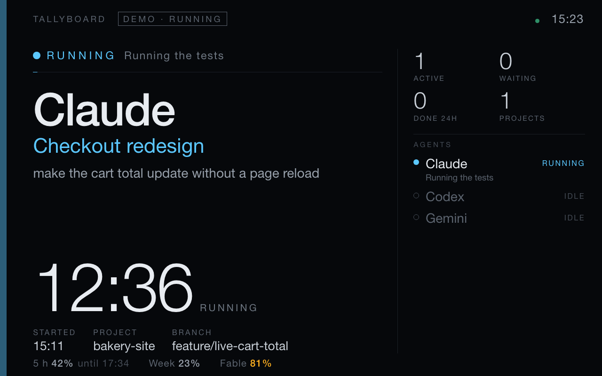
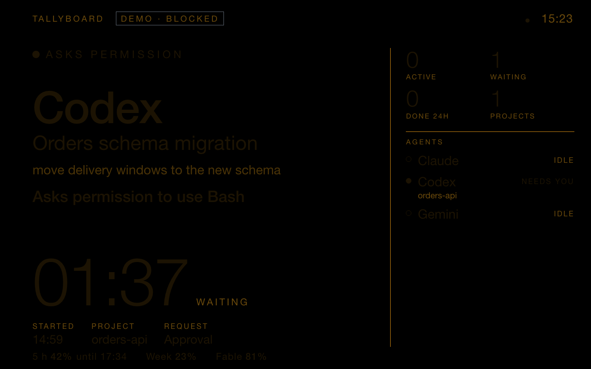
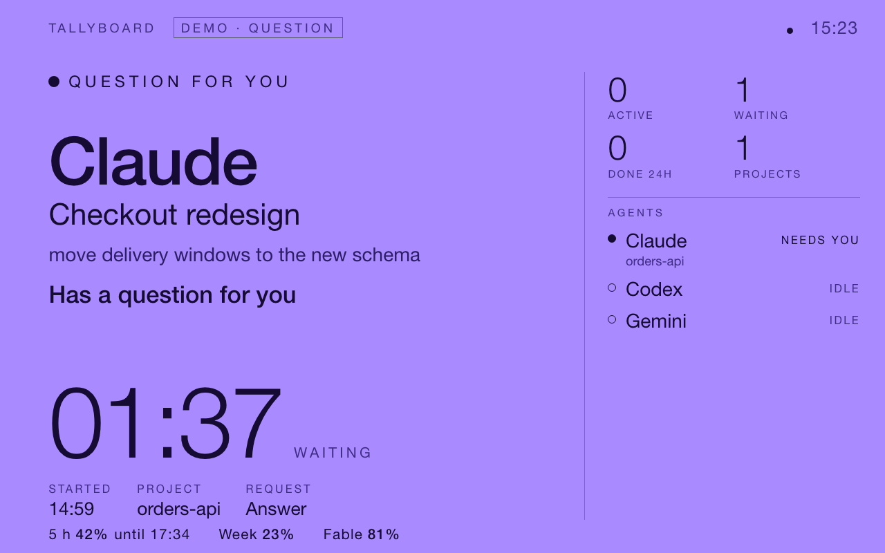
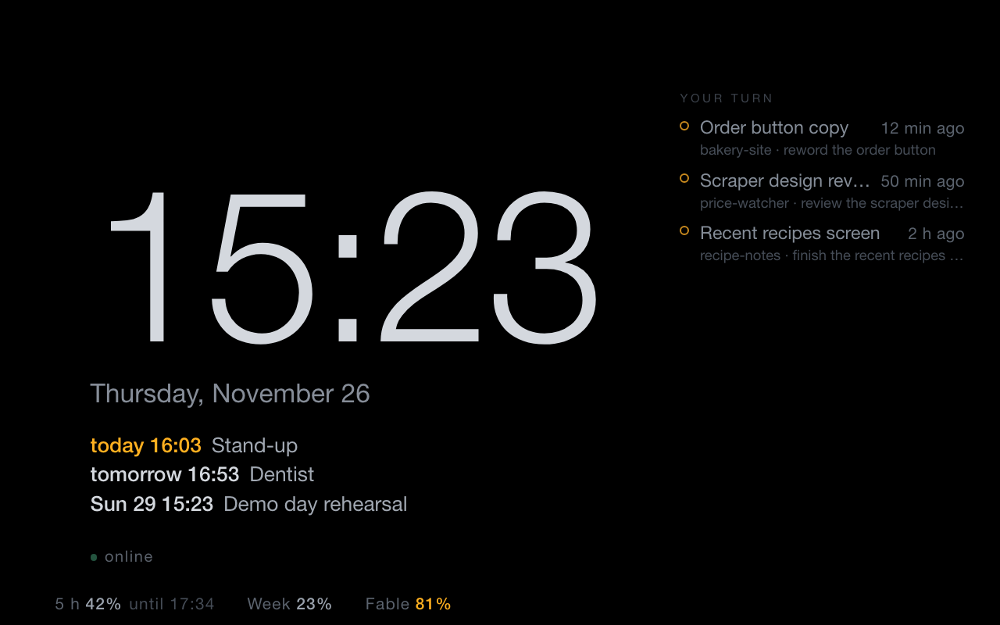

# Tallyboard

Give an old tablet a job: a desk status board for your coding agents.

In a TV studio, the tally light tells you which camera is live. Tallyboard does
that for Claude Code and friends. Prop a retired tablet next to your monitors
and a glance tells you which session is working, which one finished and is
waiting for you, and which one is stuck on a permission or a question.


*The desks in the clip are generated illustrations. Every screen on the tablets is a real capture of Tallyboard's sample mode, and the sounds are the ones the tablet plays.*

| Working | Needs permission |
|---|---|
|  |  |
| **Has a question** | **Your turn** |
|  |  |

These are the built-in sample screens (`?demo=...`), so they never show real work.

## What it shows

- **Running**: which agent, which session, what it is doing right now ("Editing theme.css").
- **Needs you**: the whole screen turns amber for a permission request and violet for a question, with a short sound from the tablet.
- **Your turn**: a list of sessions that finished and are waiting for your reply. Tap one to open it on the computer; hold one to wave it off the list.
- **Idle**: a large clock, the date, your next appointments and how much of your plan you have used.

It is deliberately quiet. Nothing blinks unless something needs you, and an
alert nobody answers settles into a dim version of itself after three minutes.

## What you need

- A Mac running Claude Code. The board itself is plain Python 3 from the system, with no packages to install.
- Linux has not been tried: the server and hook are plain Python and should run, but the installer only sets up a background service on macOS and prints the start command elsewhere. Windows is not supported yet.
- Any tablet with a web browser on the same Wi-Fi. The page is written for very old browsers (Android 5 era), so almost anything works.
- Optional: a kiosk browser on the tablet so the page stays full screen.

Tallyboard was built and tested on one device: a very old Amazon Fire HD 10 (2017, Fire OS 5, which is Android 5.1) running Fully Kiosk Browser. That is the only tablet it is known to work on. The page avoids modern browser features on purpose, so other old Android tablets and old iPads should work too, but nobody has tried yet. If you do, please [open an issue](../../issues) and say how it went.

## Install

```bash
git clone https://github.com/irvingellan/tallyboard.git
cd tallyboard
python3 install.py install
```

It prints the address to open on the tablet, for example `http://192.168.0.12:5199/`.
To look around before any agent runs, add `?demo=cycle` to that address.

The installer does three things and nothing else:

1. copies the app to `~/.local/state/tallyboard/app`;
2. adds its status hook to `~/.claude/settings.json`, beside your existing hooks, after saving a backup of that file;
3. registers a per-user background service (`local.tallyboard.server`).

`python3 install.py install --dry-run` shows the plan without changing anything.
`python3 install.py status` shows what is installed.
`python3 install.py uninstall` removes exactly those three things and leaves the rest of your settings as they were.

For Portuguese on screen: `python3 install.py install --lang pt-BR`.

## Options

Settings live in `~/.local/state/tallyboard/config.json`. The installer turns
on the sound and nothing else; every other option is off until you add it. Restart the service after editing
(`launchctl kickstart -k gui/$(id -u)/local.tallyboard.server`).

| Setting | What it does |
|---|---|
| `"lang": "pt-BR"` | Words on screen. `en` (default) or `pt-BR`. |
| `"sound": true` | The tablet plays two rising notes when a session finishes its turn, four alternating notes when one needs you. Silent 23:00 to 07:00. Kiosk browsers play it unprompted; an ordinary browser stays silent until you tap the page once. Set to `false` to mute. |
| `"codex": true` | Also lists Codex threads, read from Codex's own index on this computer. Shows each thread's name and title (the first line of your first message). |
| `"antigravity": true` | Also lists Antigravity (Gemini) conversations, read from the app's own index. |
| `"usage": true` | Shows your Claude plan usage. Needs the CodexBar app's command-line tool. |
| `"roster": ["claude", "codex", "gemini"]` | Which agents are always listed, in order. Set `available_agents` to the same list. |
| `"tablet": {"serial": "..."}` | For an Android tablet reachable over ADB: sets the backlight to match the screen and reloads the page if it goes silent. |

Appointments come from a small file, `agenda.json`, in the same folder; the
shape is documented at the top of `tallyboard/agenda.py`. Anything that can
write that file can feed it. The author refreshes it from Google Calendar with
a scheduled Claude task three times a day.

Codex, Antigravity, plan usage and tap-to-open read files and formats that
belong to other apps and can change without notice. They were working with
Codex CLI 0.172, Antigravity 2.35 and the Claude desktop app as of November
2026. When one of them stops matching, that part shows nothing; the rest keeps
working.

## Privacy and safety

- **Local network only.** The server answers private addresses (192.168.x.x, 10.x.x.x, 172.16-31.x.x) and refuses everything else. It has no account, no cloud and no telemetry.
- **Anyone on your Wi-Fi can read the board.** There is no password. Do not run it on a network you do not trust.
- **What the board shows, and therefore what the hook stores:** for each session, the first line of your prompt, the session's name in the Claude app, the project folder's name, the git branch, the name of the tool in use, a file's base name, and the short description the agent wrote for a command. Text that looks like a key, token or local path is blanked before display.
- **What it never stores:** your code, command lines, full paths, file contents, or anything the agent replied.
- **What a tap can do.** Two things: ask the computer to bring that session's window forward in the Claude app, and hide a row from the "Your turn" list. Any device on your network can send those two requests, not only your tablet. Neither can approve a permission, answer a question or send a message. To make the tablet display-only, install with `python3 install.py install --no-touch`.
- **The other apps are only read.** Codex and Antigravity are opened read-only. Their indexes are SQLite databases in write-ahead mode, so reading them can create or touch the small `-shm` side file next to them; nothing else is written there.

## Good to know

- **Give the computer a fixed address.** The tablet opens the board by the computer's IP. If your router hands the computer a new address, the tablet shows an error until you reload it with the new one. Reserving the address in the router avoids that.
- **The page reloads itself once a night**, around 4 a.m. while idle, because very old browsers slow down when a page stays open for days. If that reload lands while the computer is asleep or restarting, the tablet can be left on an error page until it is reloaded. With the optional `tablet` setting (Android over ADB) the computer notices and reloads it.
- **A tablet on a weak charger may not keep up.** Screens that stay on all day need a real wall charger.

## How it works

```
Claude Code hook  ->  one small JSON file per session  ->  local web server  ->  tablet browser
                      (~/.local/state/tallyboard/agents.d)   (polls every 3 s)
```

The hook runs on seven Claude Code events and rewrites that session's file.
The server turns all the files into one "view" and the page draws it. The page
is plain ES5 and CSS without variables or grid, so a ten-year-old WebView
renders it. Any tool can add itself to the board by writing a file of the same
shape into `agents.d`.

## Development

```bash
python3 tests/test_console.py
python3 tests/test_install.py
python3 tests/test_safety.py
node --test tests/*.mjs
```

The installer tests run entirely inside a temporary folder and never touch
your real settings.

## Contributing

This started as one person rescuing one tablet, and it is open to ideas, fixes and new directions. See [CONTRIBUTING.md](CONTRIBUTING.md). The most useful things right now:

- **Try it on another tablet** (old iPad, old Android, e-reader browser) and report what happened.
- **Add a language.** All the words on screen live in one table at the top of `tallyboard/static/console.js`.
- **Add an agent.** Anything that writes a small JSON file can appear on the board.
- **Make it run as a service on Linux or Windows.**

## License

MIT. See `LICENSE`.
